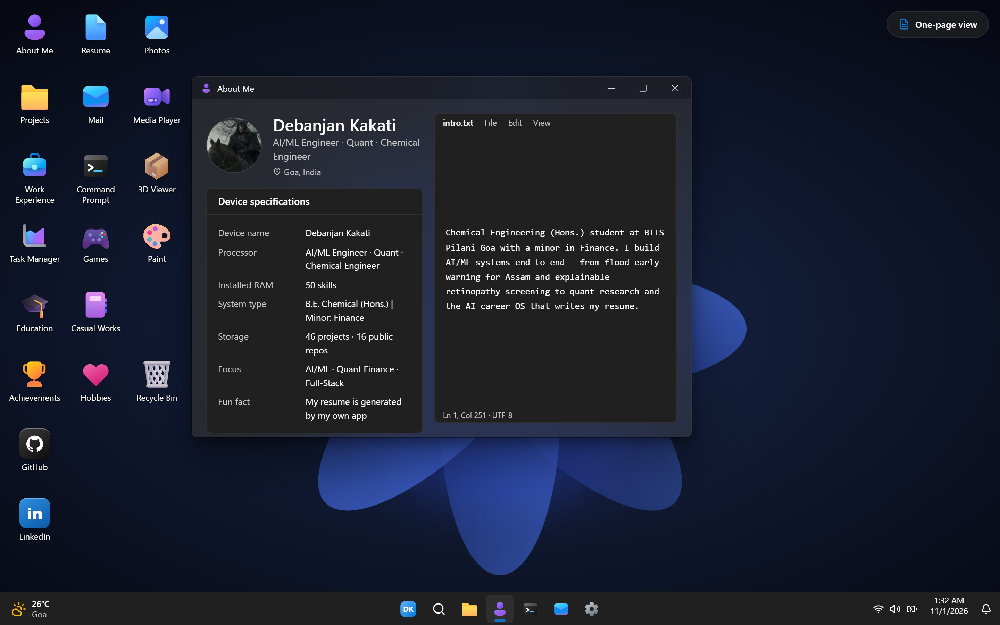
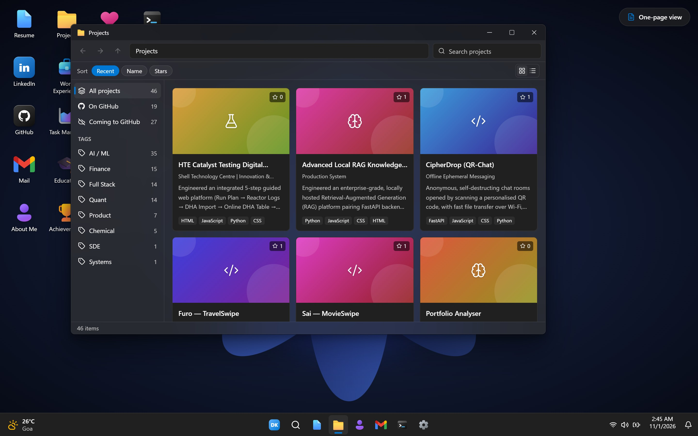
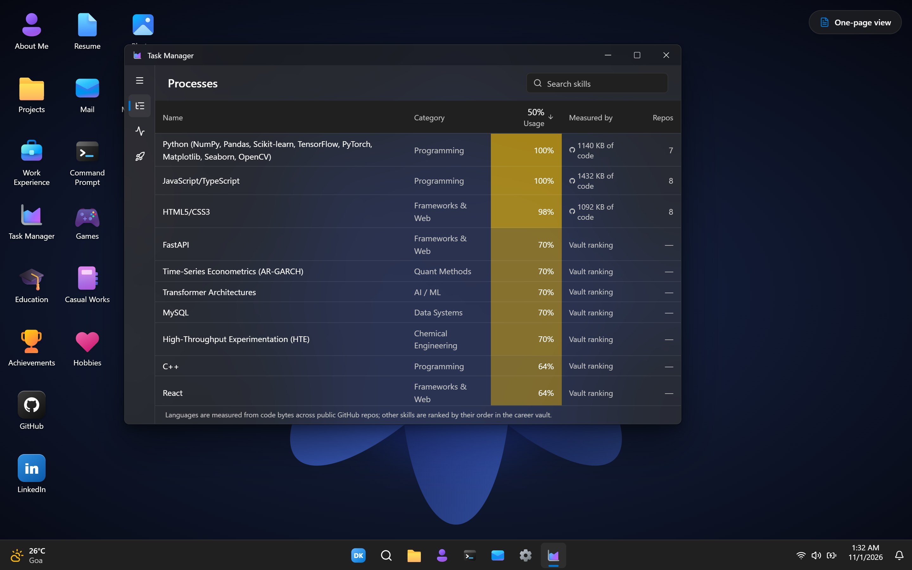

<div align="center">

# Debanjan Kakati · Portfolio OS

**An interactive Windows 11-style desktop that works as my portfolio.**
Open apps, browse projects in File Explorer, check my skills in Task Manager, or type commands into Command Prompt.

AI/ML Engineer · Quant · Chemical Engineer · BITS Pilani, Goa

<!-- Add the live link after the first deploy: [**Live site →**](https://your-site.vercel.app) -->
[LinkedIn](https://www.linkedin.com/in/debanjan-kakati-5517891b7/) · [GitHub](https://github.com/DEBANJAN-KAKATI)




</div>

## Why a desktop?

A portfolio is something people explore, so I built one you can explore like a computer. Every window shows real data: projects, experience and skills come from my career vault ([jstMyRB](https://github.com/DEBANJAN-KAKATI/jstMyRB)) and my GitHub account. A scheduled sync keeps them current without me hand-editing the site. If you'd rather just read, **One-page view** shows everything as a single scrolling page.

## Highlights

- **A working desktop shell.** A boot sequence, lock screen, draggable and resizable windows with edge snapping, a taskbar, Start menu with search, widgets, quick settings, notifications, and an Alt+\` window switcher.
- **Content as apps.** Each part of the portfolio is a familiar Windows app (see the table below), loaded only when it's opened.
- **Live data pipeline.** A GitHub Action merges the published career-vault export with live GitHub repository data. It validates everything with Zod and opens a pull request with a changelog, which the site also shows in its *Windows Update* app.
- **Honest skill numbers.** Language usage in Task Manager is measured from code bytes across my public repositories. Other skills are ranked by the career vault, and the table says which is which.
- **Dev Mode for editing in place.** After a password login, I can add or edit anything, drag and drop images, videos and 3D models onto the desktop, and publish. Publishing commits to the repo or opens a pull request. Visitors never download this code.
- **Personalization.** Light and dark themes, accent colours, wallpapers that follow the time of day, and retro Windows 95 / XP skins.



| App | What it shows |
| --- | --- |
| **About Me** | Profile, "device specifications" and an intro typed out in Notepad |
| **Projects** | File Explorer of 45+ projects with tags, GitHub stats, README excerpts and project pages |
| **Work Experience** | Folders per company and a vertical timeline |
| **Task Manager** | Skills as processes, with usage measured from GitHub code |
| **Achievements** | Certifications, awards and positions of responsibility as flip cards |
| **Education** | Degree and coursework in a System Information view |
| **Casual Works** | Experiments and blog posts written in Markdown |
| **Photos · Media Player · 3D Viewer** | Gallery with slideshow; YouTube, Vimeo and uploaded videos; interactive `.glb` models |
| **Command Prompt** | `help`, `whoami`, `projects`, `skills`, `neofetch`, a virtual file system and a few easter eggs |
| **Resume** | The PDF rendered in-app with pdf.js, plus a download button |
| **Mail** | A contact form |
| **Windows Update** | Changelog from each sync |
| **Settings · Paint · Recycle Bin** | Themes and wallpapers, a drawing canvas, and some playful extras |



## Tech stack

| Area | Tools |
| --- | --- |
| UI | React 19, Tailwind CSS 4, Framer Motion, Lucide and Microsoft Fluent icons |
| State and data | Zustand, Zod schemas, a typed build step that generates `src/data/generated/` |
| 3D and media | Three.js, React Three Fiber and drei, pdf.js, marked with DOMPurify |
| Build | Vite 8 (Rolldown), with each app in its own code-split chunk |
| Backend | Vercel serverless functions (`api/`) for Dev Mode: scrypt passwords, signed session cookies, CSRF checks, rate limiting via Upstash, Vercel Blob for large media |
| Automation | GitHub Actions for the daily sync, the GitHub REST and Git Data APIs for publishing |

## How the data flows

```
jstMyRB career vault ── "Publish to Portfolio" ──► data/vault.public.json ─┐
GitHub repositories ─── daily GitHub Action ─────► data/github.snapshot.json ├─► merge + validate ─► src/data/generated/
Dev Mode edits ──────── Publish ─────────────────► content/*.json           │     (portfolio.json, changelog.json)
                                                   data/vault.inbox.json ───┘
```

- **The vault is the source of truth** for projects, experience, skills, education and achievements. Only an allow-listed public export is published. The phone number, job tracker, cover letters and private items never leave the vault.
- **GitHub fills in the rest:** stars, languages, topics, README excerpts and new repositories. New repositories arrive as drafts that stay hidden until approved.
- **Dev Mode edits to vault-owned items** go to `data/vault.inbox.json`, and jstMyRB's *Pull from Portfolio* brings them back into the vault. Everything else, such as photos, hobbies and layout, lives in `content/`.

## Getting started

Requires **Node.js 20.19+**.

```bash
git clone https://github.com/DEBANJAN-KAKATI/Portfolio_OS.git
cd Portfolio_OS
npm install
npm run dev
```

Open http://localhost:5173.

| Script | What it does |
| --- | --- |
| `npm run dev` | Start the dev server, including the Dev Mode API |
| `npm run build` | Validate data, then build to `dist/` |
| `npm run preview` | Serve the production build locally |
| `npm test` | Run the data-pipeline and Dev Mode security tests |
| `npm run sync` | Fetch GitHub data and rebuild the generated data |
| `npm run build:data` | Rebuild the generated data from what's already in `data/` and `content/` |
| `npm run import-vault -- <file>` | Import a jstMyRB vault export by hand |
| `npm run hash-password -- --env-local` | Set the Dev Mode password for local use |

### Dev Mode

Run `npm run hash-password -- --env-local` and restart the dev server. Then open **Command Prompt** on the desktop and type `sudo devmode`. Locally, publishing writes into the project folder. The full guide, including the Vercel environment variables, is in [docs/DEV_MODE.md](docs/DEV_MODE.md).

## Deployment

1. Import the repository into [Vercel](https://vercel.com/new). The framework preset is Vite and the output folder is `dist`.
2. Optionally add the Dev Mode environment variables from [`.env.example`](.env.example).
3. Every push to `main` deploys. The **sync** workflow runs daily, whenever the vault export or inbox changes, and on demand. It proposes data updates as a pull request.

Site-wide settings (owner, repository, sync behaviour, Dev Mode limits) live in [`portfolio.config.js`](portfolio.config.js), which must never contain secrets.

## Project structure

```
api/                 Serverless functions for Dev Mode (auth, upload, publish, history)
content/             Portfolio-owned content: extras, media, layout, trash
data/                Vault export, GitHub snapshot and Dev Mode inbox
docs/                Dev Mode guide and screenshots
public/              Static assets, wallpapers, media and resume
scripts/             Sync, data build, validation and password tools
src/
  apps/              One folder or file per desktop app
  data/              Schemas, adapters, merge logic and the generated data
  dev/               Dev Mode client, lazy-loaded only after login
  os/                Shell: boot, desktop, windows, taskbar, Start menu and widgets
tests/               Node test runner suites
```

## Security and privacy

- No secrets in the client or the repository. Tokens, the password hash and the session secret live only in environment variables.
- Dev Mode writes require a signed, HttpOnly, SameSite=Strict session cookie, a CSRF token and a same-origin request. Logins are rate-limited.
- Uploaded files are checked by their bytes, limited to allowed paths, and images are re-encoded to strip EXIF and GPS data.
- The published vault is built from an allow-list. Auto-generated resume bullets with invented metrics are filtered out.

## Roadmap

- Games app: Minesweeper, Snake, Memory
- Mobile layout with Live Tiles
- More easter eggs

## Credits

- Icons: [Fluent UI System Icons](https://github.com/microsoft/fluentui-system-icons) and [Fluent Emoji](https://github.com/microsoft/fluentui-emoji) by Microsoft (MIT), [Lucide](https://lucide.dev) (ISC), [Simple Icons](https://simpleicons.org) (CC0)
- Weather data: [Open-Meteo](https://open-meteo.com)
- Inspired by Windows 11. This is a fan-made portfolio, not affiliated with Microsoft.

## License

The code is released under the [MIT License](LICENSE). The personal content (text, resume, photos and other media) is © Debanjan Kakati. Please don't reuse it as your own.
